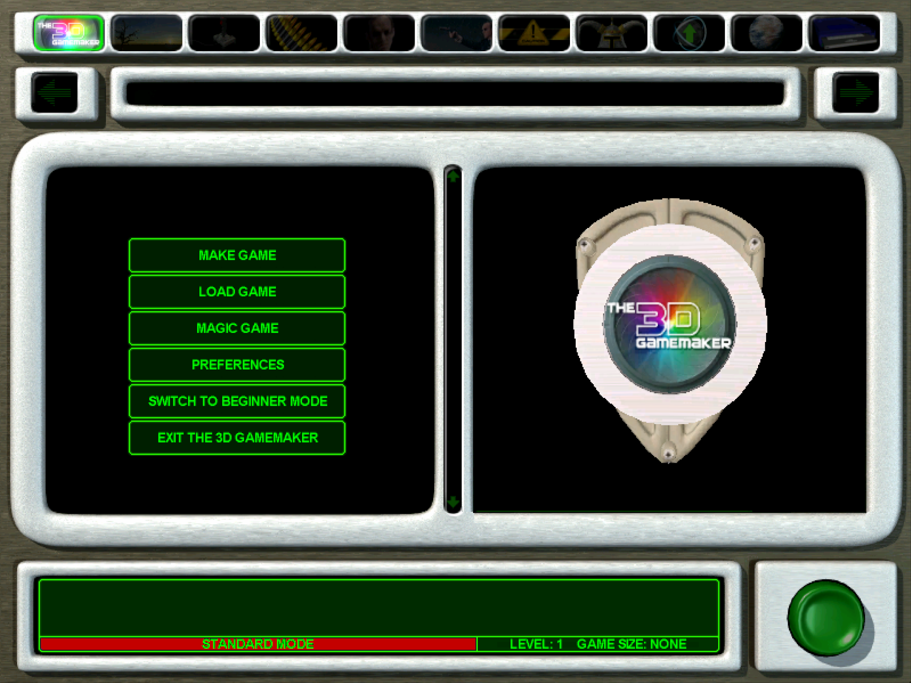

# T3DGM Compatibility Launcher

[](LICENSE)

Utility to apply a runtime patch to **The 3D Gamemaker** and install **DDrawCompat's** `DDraw.dll`.

<p align="center">
  
  <br>
  <em>The Steam release of The 3D Gamemaker running on Windows 11</em>
</p>

## Usage
### The 3D Gamemaker
Copy `T3DGM-Compatibility.exe` into your installation of The 3D Gamemaker and run it. It makes no permanent changes to the actual `t3dgm.exe` and therefore **must** be used to launch The 3D Gamemaker. Use it instead of the **LAUNCH** button inside Steam.

### Standalone games (Games built with The 3D Gamemaker)
Copy `T3DGM-Compatibility.exe` into the same folder as the game, then drag and drop the game's `.exe` file onto the launcher. Alternatively, use the command line like `T3DGM-Compatibility.exe "C:\<path to game>\<game.exe>"`. Make sure that `d3drm.dll` (not supplied) is alongside the game, or it won't run.

### DDrawCompat
Additionally, [DDrawCompat](https://github.com/narzoul/DDrawCompat) is supplied with the launcher as a recommended alternative to the `DDraw.dll` file included with the Steam release, allowing for smooth graphics processing and borderless fullscreen on modern systems. It's recommended you install DDrawCompat through this launcher to guarantee correct graphics and smooth performance. There's no reason not to use it unless it causes a specific problem for you. Non-Steam releases fall back to Windows compatibility layers which often fail, so they benefit from this as well.

## Background
The 3D Gamemaker fails to launch properly on Windows 11 because DarkBASIC attempts to use a file it does not have access to, within a "Temp" folder inside the Windows directory. This causes DarkBASIC to prematurely enter its application cleanup routine, displaying the generic DarkBASIC splash screen. Additionally, historic reports suggest that the usage of the Windows directory for temporary files would cause other issues in the software, requiring `t3dgm.exe` to be run with administrator privileges. Depending on which version of The 3D Gamemaker a game was built with, and how the author packaged it, they may also not run under modern Windows. 

## Runtime patch
`T3DGM-Compatibility.exe` replaces the temporary-root pathname in process memory after initialization, and creates session-specific folders (`t3dgm\<session>`) inside Windows' configured temporary directory (typically `%LOCALAPPDATA%\Temp`) for DarkBASIC to use instead. This allows the program loader to complete execution and run The 3D Gamemaker without using the Windows folder for temporary files.

## Compatibility
| Release | Status | Notes |
|:-----------------|:------:|:-------|
| The 3D Gamemaker (Original English CD-ROM) | ✅ | Working |
| Create your own 3D Games (2005) | ✅ | Working |
| The 3D Gamemaker (Vista Patch) | ✅ | Working |
| The 3D Gamemaker (TGC "1.1") | ✅ | Working |
| The 3D Gamemaker (Steam) | ✅ | Working |
| The 3D Gamemaker (Lite) | ❔ | Untested |
| The 3D Gamemaker (Lite - Special Edition) | ❔ | Untested |
| The 3D Gamemaker (German) | ❔ | Untested |
| The 3D Gamemaker (German Demo) | ❔ | Untested |
| The 3D Gamemaker (Polish) | ❔ | Untested |
| The 3D Gamemaker (Spanish) | ❔ | Untested |
| The 3D Gamemaker (Russian) | ❔ | Untested |

This list is not exhaustive, it only contains versions of The 3D Gamemaker that I'm aware of!

## Building from source

### Requirements
Requires Windows, Windows PowerShell 5.1 or later, and [w64devkit](https://github.com/skeeto/w64devkit) 2.11.0 (GCC 16.2.0, x86)
A copy of The 3D Gamemaker isn't required to build the launcher.

### Compilation
From the root of the repository run:

```powershell
powershell.exe -NoProfile -ExecutionPolicy Bypass -File .\source\build.ps1 `
    -Toolchain "C:\tools\w64devkit\bin" `
    -Output "C:\build\t3dgm-compatibility"
```

Replace `-Toolchain` and `-Output` paths with your own. The script verifies the bundled DDrawCompat archive and embeds its DLL into `T3DGM-Compatibility.exe`.

The executable is written to the output folder. Include the repository's `LICENSES` folder when distributing the executable.

## AI disclosure
Codex was used to write the installer and launcher as well as some test cases. All research into DarkBASIC's compatibility problems is performed by me.

## License
This project is licensed under the [MIT License](LICENSE).

Third-party components are subject to their respective licenses, which can be found in the [LICENSES](LICENSES/) directory

## Credits

- **DDrawCompat** by narzoul
- **The 3D Gamemaker** by Dark Basic Software/The Game Creators
